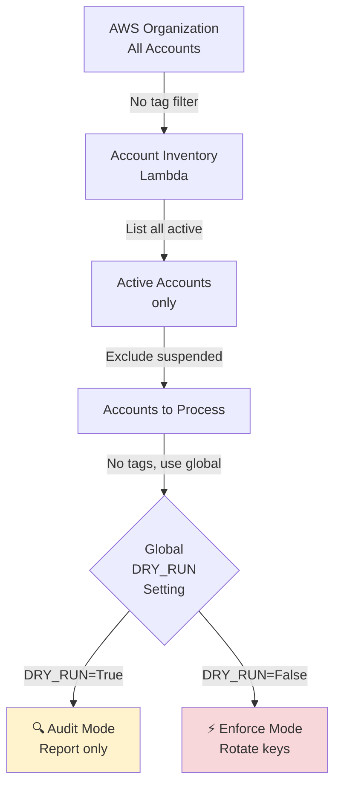
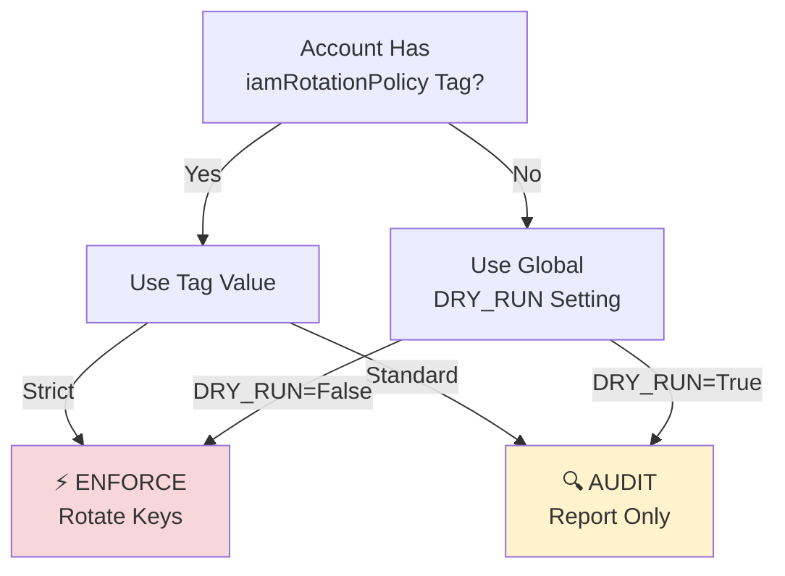
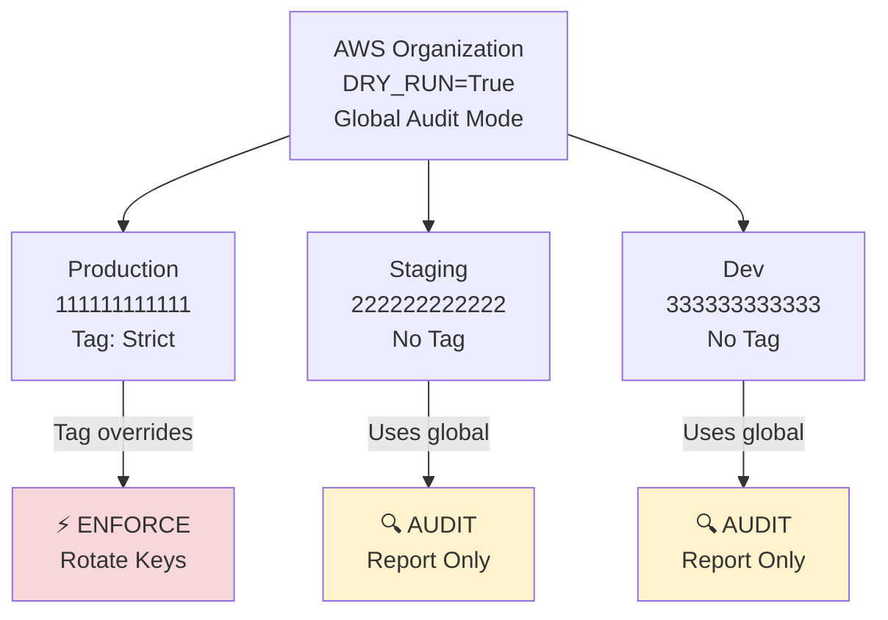
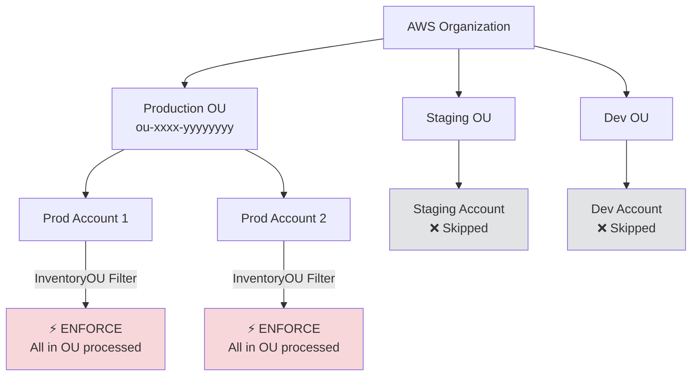
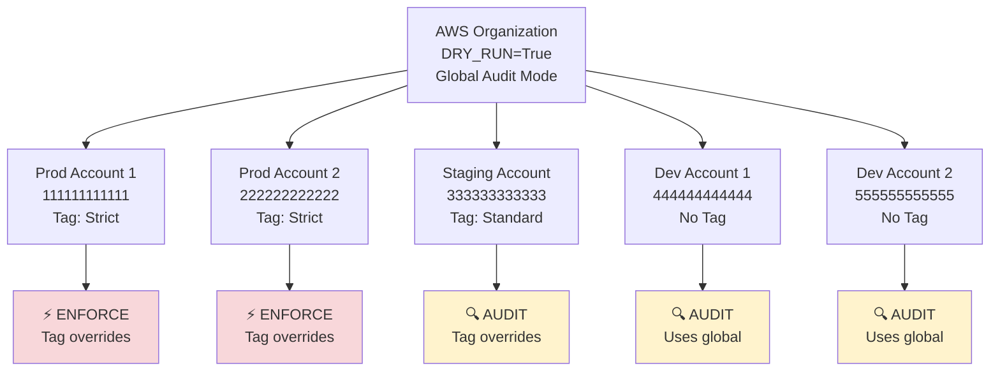
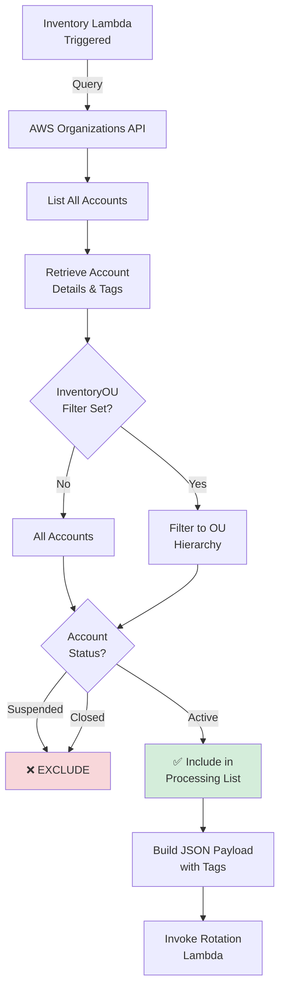
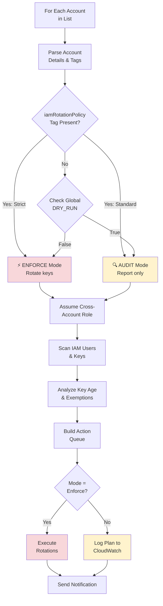
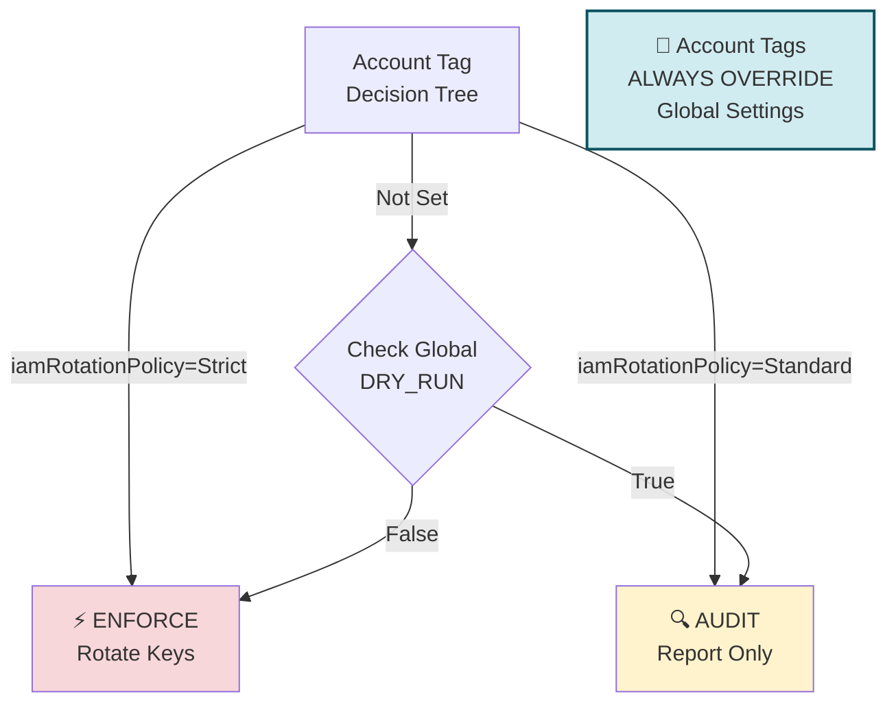

# AWS Account Tagging Guide for IAM Key Rotation

Complete reference for using AWS account tags to control IAM Key Rotation behavior across your AWS Organization.

---

## 📋 Overview

The IAM Key Rotation solution uses **AWS Organization account tags** to determine:
- Whether rotation is enabled/disabled for an account
- The rotation policy (Audit vs Enforcement mode)
- Account-level overrides and exemptions

This guide explains how tags control the solution's behavior and provides practical examples.

---

## 🔄 Default Behavior

### Accounts are Enabled by Default

**Without any tags**, all **active accounts** in the AWS Organization are processed:

| Aspect | Default Behavior |
|--------|------------------|
| **Account Inclusion** | ✅ All active accounts processed (suspended accounts excluded) |
| **Global Mode** | Uses `DRY_RUN` environment variable (audit or enforcement) |
| **OU Filtering** | Optional: Set `InventoryOU` to limit to specific OU hierarchy |
| **User Exemptions** | IAM group-based (`IAMKeyRotationExemptionGroup`) |

**Example**: If you deploy with:
- `DRY_RUN=True` (audit mode)
- No tags on any accounts
- No OU filter

→ **All active accounts** will have their keys **audited** (no actions taken)

### Default Behavior Flow



---

## 🏷️ Account-Level Tags

### Tag: `iamRotationPolicy`

Controls whether an account runs in **Audit or Enforcement** mode, overriding the global `DRY_RUN` setting.

**Location**: AWS Organizations → Accounts → Account Tags

**Supported Values**:

| Value | Effect | Use Case |
|-------|--------|----------|
| `Strict` | Forces **Enforcement Mode** (rotate keys actively) | Production accounts requiring active rotation |
| `Standard` | Forces **Audit Mode** (report only, no changes) | Test/staging accounts for validation |
| *(not set)* | Uses global `DRY_RUN` setting | Most accounts; controlled by deployment parameter |

**Precedence**:



**Examples**:

```bash
# Make production account always enforce
aws organizations tag-resource \
  --resource-id r-xxxx \  # AWS Account ID (12 digits)
  --tags Key=iamRotationPolicy,Value=Strict

# Make test account always audit
aws organizations tag-resource \
  --resource-id 123456789012 \
  --tags Key=iamRotationPolicy,Value=Standard
```

---

## 🚀 Deployment Scenarios

### Scenario 1: All Accounts in Audit Mode (Except Production)

**Goal**: Test the solution; audit all accounts except production (which enforces)

**Setup**:

```bash
# Tag production account to enforce
aws organizations tag-resource \
  --resource-id 111111111111 \  # Production
  --tags Key=iamRotationPolicy,Value=Strict

# Deploy with global audit mode
# This means: prod will enforce (due to tag), others will audit (global setting)
```

**Deploy command**:
```bash
# GitHub Actions or CLI deployment
# Environment variable: DRY_RUN=True (global audit mode)
```

**Result**:



---

### Scenario 2: Selective Account Targeting with OU Filter

**Goal**: Only process accounts in the "Production" OU, all in enforcement mode

**Setup**:

```bash
# No per-account tags needed (all will enforce)
# Use OU-level filtering instead
```

**Deploy command**:
```bash
# Set InventoryOU to Production OU
# Environment variable: DRY_RUN=False (global enforcement)
```

**Sceptre config** (`config/prod/account-inventory.yaml`):
```yaml
parameters:
  InventoryOU: "ou-xxxx-yyyyyyyy"  # Production OU ID only
```

**Result**:



---

### Scenario 3: Mixed Environments (Production & Staging)

**Goal**: 
- Production accounts enforce rotations
- Staging accounts audit only
- Development accounts excluded entirely

**Setup**:

```bash
# Production accounts - enforce
aws organizations tag-resource \
  --resource-id 111111111111 \  # Prod Account 1
  --tags Key=iamRotationPolicy,Value=Strict

aws organizations tag-resource \
  --resource-id 222222222222 \  # Prod Account 2
  --tags Key=iamRotationPolicy,Value=Strict

# Staging accounts - audit
aws organizations tag-resource \
  --resource-id 333333333333 \  # Staging Account
  --tags Key=iamRotationPolicy,Value=Standard

# Development accounts - no tag (will use global setting)
# (Leave untagged, will follow global DRY_RUN)
```

**Deploy command**:
```bash
# Global setting: DRY_RUN=True (default for untagged accounts)
# This creates:
#   - Production: Enforces (explicit Strict tag)
#   - Staging: Audits (explicit Standard tag)
#   - Development: Audits (global setting)
```

**Result**:



**Result Matrix**:
```
Account          | Tag Value | Global DRY_RUN | Final Mode | Notes
-----------------+-----------+----------------+------------+--------
Prod 1           | Strict    | True           | Enforce    | Tag overrides
Prod 2           | Strict    | True           | Enforce    | Tag overrides
Staging          | Standard  | True           | Audit      | Tag overrides
Dev 1            | (none)    | True           | Audit      | Uses global
Dev 2            | (none)    | True           | Audit      | Uses global
```

---

## 🔍 How Account Selection Works

### Step 1: Inventory Lambda Discovers Accounts



**Default**: All **ACTIVE** accounts included
- Suspended accounts automatically excluded
- Closed accounts not listed

**With OU Filter**: Only accounts in specified OU (and children)

### Step 2: Rotation Lambda Processes Each Account

For each account in the list:



---

## 📋 Complete Account Tag Reference

### Supported Tags

| Tag Key | Values | Scope | Default | Required |
|---------|--------|-------|---------|----------|
| `iamRotationPolicy` | `Strict`, `Standard` | Per-Account | Uses global `DRY_RUN` | No |

### Future Tag Support (Reserved)

These tags may be supported in future versions:

| Tag Key | Proposed Values | Purpose |
|---------|-----------------|---------|
| `iamRotationEnabled` | `true`, `false` | Explicit enable/disable (not yet implemented) |
| `iamRotationMaxAge` | Days (e.g., `90`) | Account-specific key age threshold |
| `iamRotationExcludeUsers` | Pattern (e.g., `service-*`) | Exclude specific users per account |

---

## 🛠️ Management Operations

### List Current Tags on All Accounts

```bash
#!/bin/bash
# list-account-tags.sh

echo "Account ID          | Account Name          | iamRotationPolicy"
echo "--------------------+-----------------------+------------------"

aws organizations list-accounts \
  --query 'Accounts[].[Id,Name]' \
  --output text | while read ACCOUNT_ID ACCOUNT_NAME; do
  
  TAGS=$(aws organizations list-tags-for-resource \
    --resource-id "$ACCOUNT_ID" \
    --query "Tags[?Key=='iamRotationPolicy'].Value" \
    --output text)
  
  TAG_VALUE="${TAGS:-(not set)}"
  printf "%-20s | %-23s | %s\n" "$ACCOUNT_ID" "$ACCOUNT_NAME" "$TAG_VALUE"
done
```

**Run**:
```bash
chmod +x list-account-tags.sh
./list-account-tags.sh
```

### Apply Tag to All Production Accounts

```bash
#!/bin/bash
# tag-production-accounts.sh

PRODUCTION_OU="ou-xxxx-yyyyyyyy"  # Your Production OU ID

echo "Tagging all accounts in Production OU as iamRotationPolicy=Strict..."

aws organizations list-accounts-for-parent \
  --parent-id "$PRODUCTION_OU" \
  --query 'Accounts[].Id' \
  --output text | tr '\t' '\n' | while read ACCOUNT_ID; do
  
  aws organizations tag-resource \
    --resource-id "$ACCOUNT_ID" \
    --tags Key=iamRotationPolicy,Value=Strict
  
  echo "✓ Tagged account $ACCOUNT_ID"
done

echo "✓ Complete"
```

### Remove Tag from Account

```bash
aws organizations untag-resource \
  --resource-id 123456789012 \
  --tag-keys "iamRotationPolicy"

echo "✓ Tag removed; account will use global DRY_RUN setting"
```

---

## 📊 Tag Behavior Matrix

This matrix shows how tags and global settings interact:



**Truth Table**:

| Account Tag | Global DRY_RUN | Final Behavior |
|-------------|----------------|----------------|
| `Strict` | Any | ⚡ **ENFORCE** - rotate keys |
| `Standard` | Any | 🔍 **AUDIT** - report only |
| *(not set)* | `False` | ⚡ **ENFORCE** - rotate keys |
| *(not set)* | `True` | 🔍 **AUDIT** - report only |

**Key Insight**: Account tags **always override** the global setting.

---

## ✅ Common Patterns

### Pattern 1: Progressive Rollout

**Phase 1**: Audit all accounts
```bash
# Global: DRY_RUN=True
# No tags needed
# Result: All accounts audit-only
```

**Phase 2**: Enforce in canary accounts
```bash
aws organizations tag-resource \
  --resource-id 111111111111 \  # First production account
  --tags Key=iamRotationPolicy,Value=Strict
# Result: Canary enforces; others still audit
```

**Phase 3**: Expand to all production
```bash
# Tag all production accounts with Strict
# Keep staging/dev untagged (they remain in audit mode)
```

---

### Pattern 2: Environment-Based Control

Use OU structure + tags for environment targeting:

```
AWS Organization
├── Production OU
│   ├── Prod Account 1 [Tag: Strict]
│   ├── Prod Account 2 [Tag: Strict]
│   └── Prod Account 3 [Tag: Strict]
├── Staging OU
│   ├── Staging Account 1 [Tag: Standard]
│   └── Staging Account 2 [Tag: Standard]
└── Development OU
    ├── Dev Account 1 [no tag - uses global]
    └── Dev Account 2 [no tag - uses global]
```

**Deployment 1** (Test):
- `DRY_RUN=True` (global audit)
- All accounts audit-only

**Deployment 2** (Production):
- `DRY_RUN=False` (global enforce)
- Production: Enforces (explicit tag)
- Staging: Audits (explicit tag)
- Development: Audits (fallback to global)

---

### Pattern 3: Gradual Key Rotation Thresholds

Once `iamRotationMaxAge` tag is supported:

```bash
# High-risk production: rotate at 60 days
aws organizations tag-resource \
  --resource-id 111111111111 \
  --tags Key=iamRotationMaxAge,Value=60

# Standard production: rotate at 90 days (default)
aws organizations tag-resource \
  --resource-id 222222222222 \
  --tags Key=iamRotationMaxAge,Value=90

# Low-risk test account: rotate at 120 days
aws organizations tag-resource \
  --resource-id 333333333333 \
  --tags Key=iamRotationMaxAge,Value=120
```

---

## 🔐 Security Considerations

### Tag-Based Access Control

⚠️ **Important**: Only users with Organizations permissions can tag accounts.

Restrict tagging to infrastructure/security teams:

```json
{
  "Version": "2012-10-17",
  "Statement": [
    {
      "Effect": "Allow",
      "Action": [
        "organizations:TagResource",
        "organizations:UntagResource",
        "organizations:ListTagsForResource"
      ],
      "Resource": "arn:aws:organizations::*:account/o-*/*"
    }
  ]
}
```

### Audit Tags with CloudTrail

Track tag changes:

```bash
aws cloudtrail lookup-events \
  --lookup-attributes AttributeKey=ResourceName,AttributeValue=123456789012 \
  --lookup-attributes AttributeKey=EventName,AttributeValue=TagResource \
  --query 'Events[].{Time:EventTime,User:Username,Event:EventName}' \
  --output table
```

---

## 🐛 Troubleshooting

### Account Not Processed

**Symptom**: Expected account missing from rotation

**Check**:
1. Is account active? (Suspended accounts excluded)
2. Is OU filter applied? (`InventoryOU` parameter)
3. Check CloudWatch logs:
```bash
aws logs tail /aws/lambda/Account-Inventory-Lambda --follow
```

### Tag Not Applied

**Symptom**: Account tag changed but behavior unchanged

**Note**: Tags are read at rotation runtime
- Changes take effect on next scheduled run (5 AM UTC daily)
- Or manually invoke rotation Lambda to test immediately

**Check**:
```bash
aws organizations list-tags-for-resource \
  --resource-id 123456789012 \
  --query 'Tags[?Key==`iamRotationPolicy`]'
```

### Conflicting Tag Values

**Symptom**: Account has multiple conflicting tags

**Note**: Only `iamRotationPolicy` is currently supported
- If accidentally set multiple tags, remove extras:
```bash
aws organizations untag-resource \
  --resource-id 123456789012 \
  --tag-keys "WrongTagKey"
```

---

## 📖 Related Documentation

| Document | Purpose |
|----------|---------|
| [SETUP_TWO_ORGS.md](SETUP_TWO_ORGS.md) | Initial AWS/GitHub setup |
| [OPERATIONS.md](../docs/OPERATIONS.md) | Day-to-day operations |
| [ARCHITECTURE.md](../docs/ARCHITECTURE.md) | System design and flow |

---

## 📞 Quick Reference

### Enable Enforcement for Account
```bash
aws organizations tag-resource \
  --resource-id <ACCOUNT_ID> \
  --tags Key=iamRotationPolicy,Value=Strict
```

### Enable Audit-Only for Account
```bash
aws organizations tag-resource \
  --resource-id <ACCOUNT_ID> \
  --tags Key=iamRotationPolicy,Value=Standard
```

### Remove Account Tag (Use Global Setting)
```bash
aws organizations untag-resource \
  --resource-id <ACCOUNT_ID> \
  --tag-keys iamRotationPolicy
```

### Check Account Tag
```bash
aws organizations list-tags-for-resource \
  --resource-id <ACCOUNT_ID> \
  --query 'Tags[?Key==`iamRotationPolicy`].Value' \
  --output text
```

---

**Last Updated**: 2026-08-04  
**Status**: Complete  
**Tag Support**: `iamRotationPolicy` (fully implemented)
